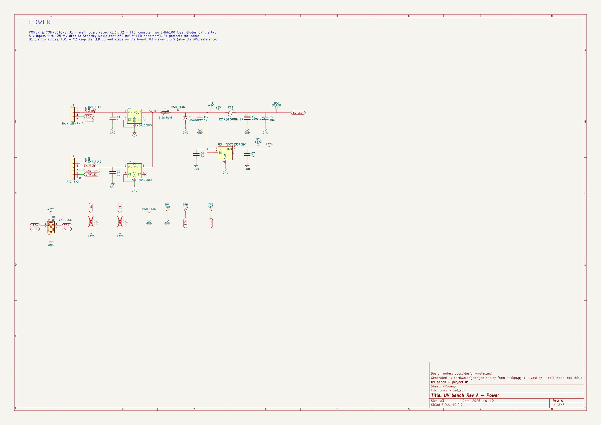
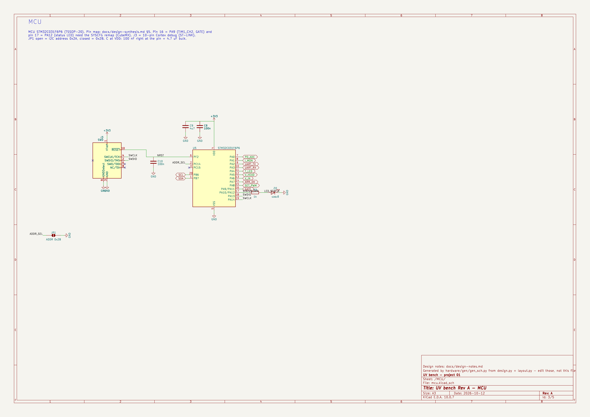
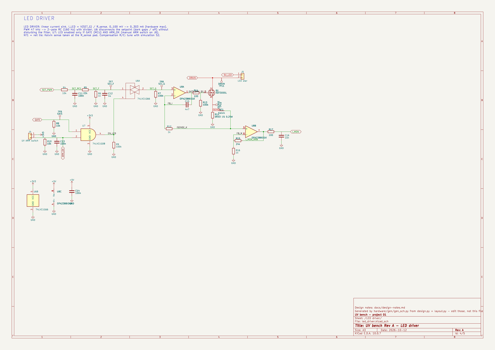
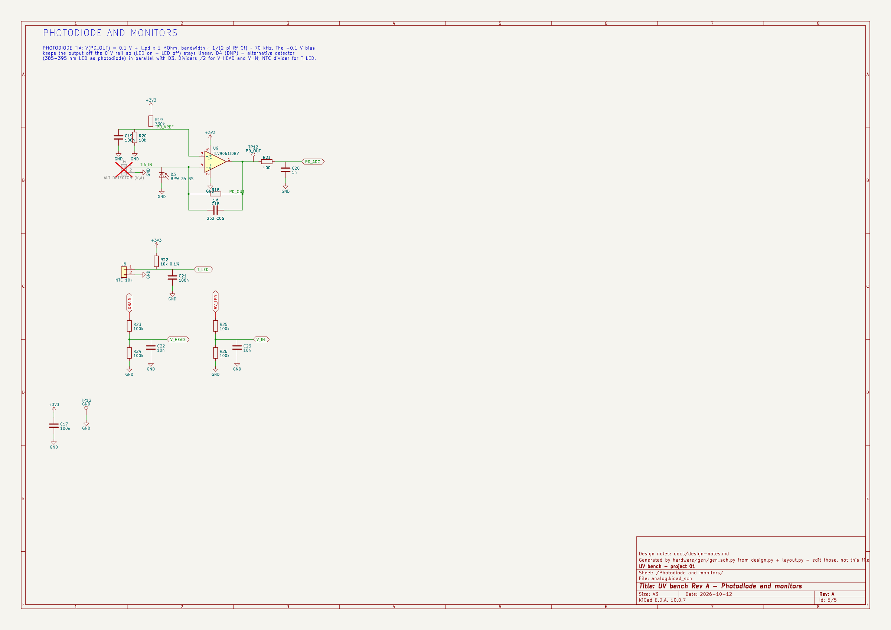
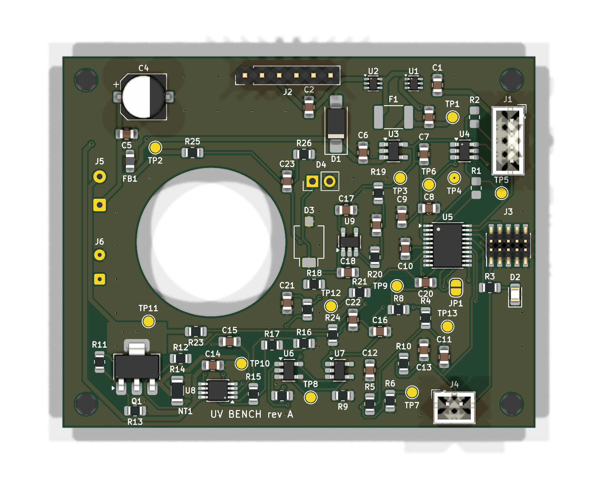
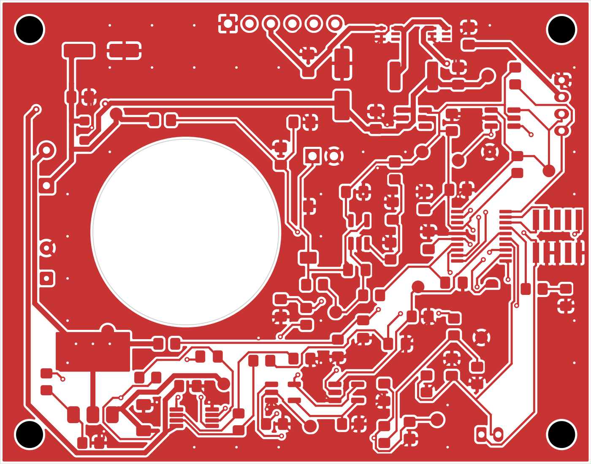
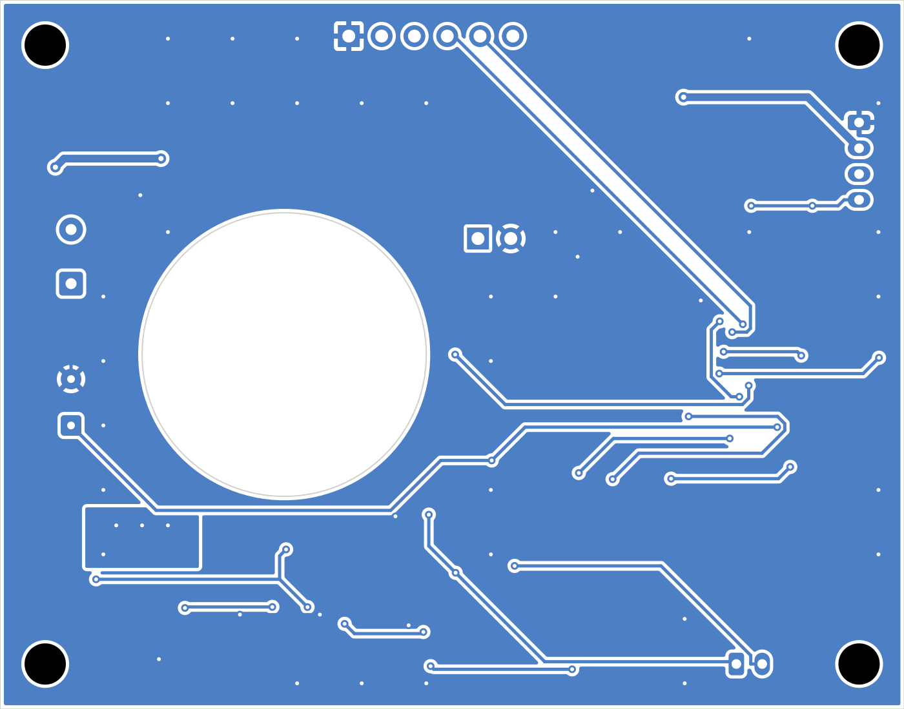

# UV bench Rev A: design notes (how and why)

> **Rev A document, kept for reference (2026-10-13).** The board was simplified to Rev B:
> [`rev-b-simple.md`](rev-b-simple.md). Rev A's KiCad files are in [`hardware/archive/rev-a/`](../hardware/archive/rev-a/).

This is the "lab notebook" of the Rev A board: **how the KiCad files were produced**, **why each
value is what it is** (with the calculation), and **what you must still check yourself** before
ordering. The concept and part choices are in [`design-synthesis.md`](design-synthesis.md); the
full generated list of parts and connections is in [`parts-list.md`](parts-list.md).

## 1. Method: a design generated from data

Instead of drawing by hand, the circuit is written once as data and turned into KiCad files by
scripts. In professional terms this is "schematic as code". It makes the design reviewable
(one line per component, with its nets) and regenerable: change a value, re-run, and the
schematic, PCB, BOM and docs follow.

```
hardware/gen/design.py      the circuit: every part = (ref prefix, symbol, value, footprint, pin -> net, MPN)
hardware/gen/layout.py      the drawing: where each symbol sits and the path of each wire inside a block
        │  gen_sch.py       → uv-bench.kicad_sch + 4 sheets, docs/parts-list.md, netlist check
        ▼
hardware/uv-bench/*.kicad_sch ──(kicad-cli: netlist)──► gen_pcb.py + placement.py → uv-bench.kicad_pcb (placed)
                                                              │  route.py (Freerouting) → routed + GND pours
                                                              │  fixups.py (hand touches) + silk.py (labels)
                                                              ▼
                                         tools/kicad-check.sh → ERC, DRC, Gerbers, drill, BOM, positions, STEP
```

Commands (with KiCad closed, from `projects/01-uv-bench/hardware/gen/`):

```bash
python3 gen_sch.py                                     # schematic + parts list
~/Applications/kicad-10.0.7/bin/python3.11 gen_pcb.py  # footprints, nets, placement
~/Applications/kicad-10.0.7/bin/python3.11 route.py    # autoroute (~10 min), GND pours, stitching
~/Applications/kicad-10.0.7/bin/python3.11 fixups.py   # hand-routed finishing touches + Q1 heatsink copper
~/Applications/kicad-10.0.7/bin/python3.11 silk.py      # reference designators placed legibly
cd ../../../.. && tools/kicad-check.sh projects/01-uv-bench/hardware/uv-bench/uv-bench
```

**Rules of the game**
- Edit `design.py`, not the generated `.kicad_sch`. Once you start editing the board by hand in
  KiCad (routing tweaks, silkscreen), don't re-run `gen_pcb.py`/`route.py`: they rebuild the board
  from scratch. From that point on, schematic changes go through KiCad's *Update PCB from
  Schematic* (F8), as in a normal project.
- **Schematic style:** each functional block is drawn with real wires in signal-flow order, as a person would draw it. `layout.py` gives the position of each symbol (by where one of its pins must land) and the path of each wire. Inputs are on the left, the supply at the top, ground at the bottom.
  - Labels only link blocks and sheets (global labels, with a flag outline) and the MCU pins (normal practice for a microcontroller).
  - Pins that no drawn wire reaches get a short stub with a label or power symbol automatically.
  - Every drawn net carries a small name label on its wire, so net names (and the net classes that depend on them) are the same as in `design.py`.
- **The drawing can't change the circuit.** After writing, `gen_sch.py` checks geometrically that no wire touches another net. It then exports KiCad's own netlist and compares it with `design.py`, pin by pin and name by name, and stops with an error if anything differs. That is why the PCB didn't need to be regenerated when the schematic was redrawn (DRC parity: 0 issues).
- The UUIDs of symbols and sheets are derived from their reference (`uuid5`), so regenerating the
  schematic keeps the links to the PCB footprints valid ("schematic parity" in DRC).
- Tools and versions: KiCad 10.0.7 (its own Python has the `pcbnew` API), Freerouting 2.1.0 (it runs on
  Java 21; newer versions need Java 25), helper `tools/kisym.py` (reads KiCad 10 symbol libraries).

## 2. Circuit, block by block

| Power | MCU |
|---|---|
|  |  |
| **LED driver** | **Photodiode and monitors** |
|  |  |

(Click an image to open it full size; in KiCad, click a net label to highlight the net on all sheets.)

References below are the generated ones (see [`parts-list.md`](parts-list.md)).

### 2.1 Power (sheet "Power")

| Part | Value | Why / calculation |
|---|---|---|
| J1 | JST-PH 4 (GND, 5V, SDA, SCL) | Interface spec v1.3. Keyed and locking. Not Qwiic on purpose (Qwiic carries 3.3 V) |
| J2 | FTDI 1×6 header | PC console + alternative 5 V supply (TTL-232R-3V3 pinout: 1 GND, 3 VCC, 4 RXD-in, 5 TXD-out) |
| U1, U2 | LM66100 ideal diodes | **Diode-OR** of the two 5 V inputs. R_on ≈ 79 mΩ → 0.3 A × 79 mΩ ≈ **24 mV** drop, against ~350 mV for a Schottky. That's headroom for the LED (see the power budget in the synthesis §4). ~CE tied to GND = always enabled; the part blocks reverse current when V_OUT > V_IN. ST (status) unused |
| C1, C2 | 1 µF | Input capacitors of U1/U2 (datasheet) |
| F1 | PTC 1.1 A hold (MF-MSMF110) | Protects the cable if something shorts. A *higher* hold current was chosen on purpose: its resistance (≈ 0.06–0.2 Ω) costs only 20–60 mV of headroom. The 0.75 A version can reach 1 Ω, which would cost 0.3 V |
| D1 | SMAJ5.0A TVS | Stand-off 5.0 V, breakdown ≥ 6.4 V: inactive at the USB maximum (5.25 V), clamps hot-plug spikes |
| FB1 + C4 + C5 | Ferrite bead + 220 µF + 10 µF | LED supply `5V_LED`. The bulk capacitor supplies the LED current *steps* (switch-on, dark gaps) locally, so the cable carries almost DC and I2C sees no ground bounce (spec §2) |
| U3 | TLV75533 LDO | 3.3 V for MCU, logic, TIA. **This 3.3 V is also the ADC reference**, so its stability matters; firmware corrects with VREFINT. EN tied to IN. 1 µF in/out (C6, C7) as per datasheet |
| U4 | USBLC6-2SC6 | ESD clamp on SDA/SCL, which leave the board on a cable. ~3.5 pF per line: harmless for I2C |
| R1, R2 | 4.7 kΩ **DNP** | I2C pull-ups for standalone tests only. Normally the main board has them, and two sets in parallel would be too strong |
| #FLG | PWR_FLAG | Tells ERC that these nets are driven from outside (connector pins are "passive", so ERC would otherwise complain) |

ERC note: the two LM66100 outputs are both "power output" pins on the same net. ERC flags that by
default (two regulators fighting). Here it is intended (diode-OR), so the pin matrix entry
power-out/power-out is set to *OK* in the project (Schematic Setup → ERC → Pin Conflicts).

### 2.2 MCU (sheet "MCU")

| Part | Value | Why |
|---|---|---|
| U5 | STM32C031F6P6, TSSOP-20 | See [`design-synthesis.md`](design-synthesis.md) §5 for the pin map |
| C8, C9 | 100 nF + 4.7 µF | 100 nF right at VDD (pin 4) for fast current spikes; 4.7 µF for slower ones |
| C10 | 100 nF on NRST | ST's recommendation: filters noise on the reset pin |
| J3 | Cortex 10-pin SWD | VTref = 3.3 V so the ST-LINK adapts its levels; pin 10 = NRST. SWO is unconnected (no SWO on Cortex-M0+) |
| JP1 | Solder jumper | Open = address 0x2A, closed = 0x2B (input with internal pull-up, read at boot) |
| PC15 (pin 3) | not connected | Spare. Its test pad was removed to free routing space; the pin is still easy to reach with a probe or a wire on the TSSOP lead |
| R3, D2 | 1 kΩ + green LED | (3.3 − 2.0 V) / 1 kΩ ≈ 1.3 mA: visible, and well within the pin's drive |

### 2.3 LED driver (sheet "LED driver")

**Setpoint.** `SET_PWM` (TIM1, 46.9 kHz, 10 bit) → R4 10 k / C11 100 n → R5 22 k → R6 1 k ∥ C12 1 µF = `SET_F`.
- DC: 3.3 V × 1 k / (10 k + 22 k + 1 k) = **100 mV full scale**.
- Poles: 1/(2π·10 k·100 n) = 159 Hz and 1/(2π·(32 k ∥ 1 k)·1 µ) ≈ 164 Hz.
- PWM ripple at SET_F ≈ 3.3 V × (159/46 900)·(164/46 900) / 33 ≈ **1 µV**, far below one PWM step (100 mV / 1024 ≈ 98 µV).
- Price of that: the setpoint takes ~10 ms to settle. The power-regulation loop (1 kHz update) must therefore have a crossover of ~10–20 Hz, which is fine for a light source that holds power for seconds to hours.

**Gate (dark gaps, interlock).** U6 (analog switch) connects SET_F to SET_G only when `EN_LED` is high.
- `EN_LED` = GATE (MCU) AND ARM_OK (UV ARM switch), made by U7.
- Pull-downs make OFF the default: R8 on GATE (MCU in reset), R9 on EN_LED (U7 unpowered), R10 on ARM_OK (switch open or J4 unplugged), R7 on SET_G (switch open → 0 mA).
- Opening the switch instead of pulling the filter to ground keeps C11/C12 charged, so after a 50 µs dark gap the LED returns to exactly the same current.
- C13 with R10: τ = 1 ms debounce on the switch line. The switch only carries 0.33 mA, so prefer a switch with gold contacts ("dry circuit").

**Current sink.** U8A + Q1 + R14 force V(R14) = V(SET_G): **I_LED = V(SET_G) / 0.33 Ω, maximum 303 mA**, set by components, not by firmware (spec §5).
- R11 100 Ω (gate stopper): isolates the op-amp output from the MOSFET gate capacitance, which would otherwise eat its phase margin.
- R12 1 k + C15 4.7 n: local integrator compensation. The op-amp sees the MOSFET + sense loop through it; a starting point crossing near 1/(2π·1 k·4.7 n) ≈ 34 kHz. **Verify with simulation S2** and adjust in `design.py`.
- R13 100 k: holds Q1 off while U8 powers up.
- Q1 dissipation: (5.0 − 3.7 − 0.1 V) × 0.3 A ≈ **0.36 W**, worst case ≈ 0.5 W. SOT-223 on a copper area runs at about +30–50 K. It sits in the corner opposite the photodiode.
- R14: P = 0.3² × 0.33 ≈ 30 mW in a 1206 (0.25 W rating), 1 % tolerance.

**Kelvin connection (NT1).** The op-amp must see the voltage *across R14*, not across R14 plus the track that leads to it. 10 mm of 0.6 mm-wide 35 µm copper is R = ρL/(w·t) = 1.7e-8 × 0.01 / (0.6e-3 × 35e-6) ≈ 8 mΩ, which gives 0.3 A × 8 mΩ = 2.4 mV, or **2.4 % of the 100 mV signal**. The net tie NT1 sits *on* R14's pad: the high-current net `ISENSE` and the sense net `ISENSE_K` touch only at that point, so the sense track carries no current. This is a standard KiCad technique (net-tie footprint) worth knowing.

**Current monitor.** U8B, gain 1 + 24 k / 1 k = 25: 0.1 V → 2.5 V on `I_MON`. R17 100 Ω + C16 10 nF isolate the op-amp from the ADC's sampling kick (τ = 1 µs).

**Why OPA2388.** It is zero-drift (µV offset on a 100 mV signal → 0.01 %) and fast (10 MHz) enough to recover in a few µs after each dark gap. The library has no OPA2388 symbol: the `OPA2333xxDGK` symbol is used, because the standard dual-op-amp pinout is identical. Check that pinout in the OPA2388 datasheet (review list below).

### 2.4 Photodiode and monitors (sheet "Photodiode and monitors")

**TIA (transimpedance amplifier).** D3 (BPW 34 BS) cathode on U9's − input, anode to GND, + input at `PD_VREF`.
- Output: V(PD_OUT) = V_REF + I_pd · R_f = 0.097 V + I_pd × 1 MΩ. So 1 µA → 1.1 V.
- `PD_VREF` = 3.3 × 10 k / 340 k = 97 mV (R19/R20, C19 filters it). It keeps the dark output *above* the 0 V rail, where no single-supply op-amp is linear, so (LED on − LED off) stays accurate even for small signals. Side effect: the photodiode sits at −97 mV reverse bias, which slightly *reduces* its capacitance (good).
- Bandwidth: 1/(2π·1 MΩ·2.2 pF) ≈ **72 kHz**; settling to 0.1 % ≈ 7τ = 7 × 2.2 µs ≈ 15 µs, well inside the 50 µs dark gap.
- Stability: with C_pd ≈ 70 pF and a 10 MHz GBW, the minimum feedback capacitor is √(C_in / (2π·R_f·GBW)) = √(72 p / (2π·1 M·10 M)) ≈ 1.1 pF. 2.2 pF gives a comfortable phase margin.
- U9 TLV9061: CMOS input (pA bias, negligible against µA of photocurrent). No zero-drift needed, because offset cancels in the on − off difference.
- R21 100 Ω + C20 1 nF: the ADC's sampling capacitor (a few pF) takes its charge from C20 instead of the op-amp. Use an ADC sampling time of at least ~1.5 µs (≥ 12.5 cycles at 14 MHz).
- D4 (DNP): footprint in parallel with D3 for the alternative detector (a 385–395 nm LED used as a photodiode, see [`photodiode-selection.md`](photodiode-selection.md)). Pin 1 = cathode.
- **Layout:** D3, U9, R18, C18 are a tight cluster. The TIA − input is a 1 MΩ node, which picks up anything nearby, so it must be short and surrounded by ground.

**Monitors.**
- `T_LED`: J6 → NTC 10 k (B = 3435) on the star, R22 10 k 0.1 % pull-up. 25 °C → 1.65 V; 80 °C (R ≈ 1.66 k) → 0.47 V. C21 100 nF filters the long wires.
- `V_HEAD` (drain ÷ 2) and `V_IN` (5V_LED ÷ 2): 100 k / 100 k + 10 nF. The 10 nF acts as the charge reservoir for the ADC (10 nF against ~5 pF → 0.05 % error), so a 50 kΩ source impedance is fine.

## 3. Layout

| Decision | Why |
|---|---|
| **70 × 55 mm**, 2 layers, 1.6 mm FR4 | The footprints (hand-solder pads) cover ~1190 mm². With the Ø 22 mm cut-out, 60 × 50 mm was too tight to route and solder comfortably |
| Ø 22 mm cut-out at (122, 127.5) | The LED star (20 mm) passes through it onto the aluminium plate |
| Photodiode D3 at 14.5 mm from the LED axis | At the cut-out edge, facing the reflector's side port (synthesis §1) |
| Q1 + R14 + U8 bottom-left | The heat source is far from the photodiode; the 0.3 A loop (5V_LED → J5 → LED → J5 → Q1 → R14 → GND) stays short |
| Connectors on the edges | J1 (main board) and J3 (SWD) on the right, J2 (FTDI) on top, J4 (ARM switch) at the bottom, J5/J6 (LED/NTC wires) at the cut-out edge |
| 0805 passives, hand-solder pad variants | Easy with a fine iron; the longer pads leave room for the tip |
| 4 × M3 holes at the corners | Standoffs to the aluminium plate |

**Placement method (`placement.py`).**
- **Fixed parts** have hand-chosen positions: connectors, ICs, MOSFET, photodiode. These follow from mechanics and physics.
- **Every passive and test point is placed by a small greedy algorithm.** It tries positions on a 0.25 mm grid, spiralling outward from the pads it connects to, at 0/90/180/270°. It keeps the free spot (no courtyard overlap, inside the board, clear of the cut-out) with the shortest total connection length. Auto-placed parts keep **0.6 mm** of free space around their courtyard. With less (0.25 mm) the autorouter got stuck around U8: on 2 layers, routing channels between parts are what make a board routable.
- Power nets (GND, 3V3, 5V) are ignored when computing "connected to", because they go everywhere. Decoupling capacitors are instead told which IC pin to hug (`HUG` table).

## 4. Routing

- **Net classes** (Board Setup → Net Classes), assigned by net-name patterns:
  - `Power` 0.6 mm tracks, 0.8/0.4 mm vias: `*5V*`, `DRAIN`, `ISENSE`.
  - `Analog` 0.25 mm: `PD_*`, `TIA_*`, `SET_*`, `I_MON*`, `T_LED`, `V_HEAD`, `V_IN`.
  - Default 0.25 mm.
  - A custom DRC rule keeps analog tracks 0.5 mm from power tracks (`uv-bench.kicad_dru`).
- **Autorouting with Freerouting** (`route.py`):
  - The board is exported to Specctra DSN, the standard autorouter exchange format. Freerouting routes every net with the net-class widths, and the result (SES) is imported back.
  - Before export, *keepout* rule areas are added: a ring around the cut-out and a 0.5 mm strip along the outer edge. The router's own edge clearance is smaller than our 0.3 mm copper-to-edge rule.
  - The script adds 10 µm to every clearance in the DSN, because the router's coordinate rounding otherwise produces 0.148 mm gaps that KiCad flags against the 0.15 mm rule.
- **Ground:** GND is routed too, then **copper pours (zones) on both layers** cover all free space, and a grid of stitching vias ties them together. The pours give a low-impedance return path and shield the photodiode amplifier.
- **Is an autorouter good enough?** For a 2-layer, low-speed board like this one, yes, provided the critical parts are fixed by *placement* (short TIA input, Kelvin net tie, short LED loop). Review the routing in KiCad and improve anything that looks odd. Re-routing a track by hand (select it, press D to drag or X to route) is excellent practice.

- **Completion passes:** Freerouting sometimes leaves a connection or two. `route.py` re-exports the routed board, wiring included, and runs the router again so it only completes what's missing (up to 3 passes).
- **Hand touches (`fixups.py`)**, kept as explicit, commented code so they can be reviewed:
  - The last +5V link to U8 pin 8 is a 1.5 mm, 0.4 mm-wide track. It's narrower than the Power class because it must pass a 0.65 mm-pitch neighbour, and it only carries ~2 mA.
  - The **Q1 heatsink**: an 8.8 × 4.7 mm drain copper area on both layers (zone priority above GND) with thermal vias *beside* the tab. Vias *in* the pad would wick the solder away and make hand soldering hard. The SOT-223 on its bare pad would be ~100+ K/W; with this copper it is roughly 60 K/W, so 0.4 W → about +25 K.
- **Custom rule refinement:** the analog-vs-power 0.5 mm rule excludes tracks inside IC courtyards (`!A.intersectsCourtyard('U*')`). At 0.65 mm-pitch pins, neighbouring nets *cannot* be 0.5 mm apart. A test with a deliberately impossible limit (3 mm) confirmed that the rule is evaluated (17 hits without the exclusion, 7 with it).
- **Result:** ERC 0, DRC 0, 0 unconnected, 0 schematic-parity issues (`tools/kicad-check.sh`).

| Top (3D render) | Top copper | Bottom copper |
|---|---|---|
|  |  |  |

## 5. What I could not verify: your review list

Tick these before ordering. Each is quick, and together they're exactly the habit of a careful designer.

- [ ] **Pinouts against datasheets** (open each datasheet's pin table next to the KiCad footprint, using the *pad numbers*):
  - STM32C031F6P6 TSSOP-20
  - LM66100 SC-70-6 (1 VIN, 2 GND, 3 ~CE, 4 NC, 5 ST, 6 VOUT)
  - TLV75533 SOT-23-5
  - **OPA2388 VSSOP-8** (symbol borrowed from OPA2333)
  - TLV9061 SOT-23-5
  - 74LVC1G08/1G66 DBV
  - NDT3055L SOT-223 (1 G, 2/tab D, 3 S)
  - USBLC6-2SC6
- [ ] **Polarities:** SMAJ5.0A cathode = pad 1 (band) on +5V; BPW 34 BS cathode = pad 1; C4 + = pad 1; status LED; D4 pin 1 = cathode.
- [ ] **LM66100 diode-OR:** check in its datasheet ("ideal diode OR-ing" application) that two parts with ~CE = GND block reverse current into the unpowered input.
- [ ] **Connectors against your real cables:** JST pin 1 = GND on both ends of the main-board cable; the FTDI cable colours; the ST-LINK 10-pin orientation (key, pin 1).
- [ ] **Simulations:** S2 (current-loop step response: R11, R12, C15) and S4 (TIA: R18, C18) in KiCad's simulator, see [`verification-plan.md`](verification-plan.md). Change values in `design.py` if needed.
- [ ] **Mechanics:** print the board 1:1 (File → Print, scale 1) and lay the real LED star, reflector, connectors and switch on the paper. Check the cut-out, hole spacing and photodiode position.
- [ ] **Open the board in KiCad**, look at it in 3D (Alt+3), and read every track of the LED loop and the TIA area.
- [ ] **Parts availability:** order from [`parts-list.md`](parts-list.md) (Mouser/DigiKey/LCSC). Check the stock and that each MPN has the footprint you expect.
- [ ] **CubeMX:** assign the pins (synthesis §5), including the PA9/PA11 and PA10/PA12 remaps.
