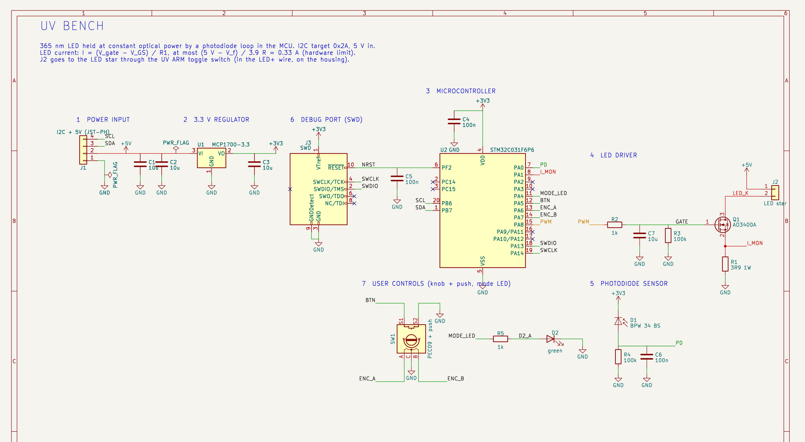
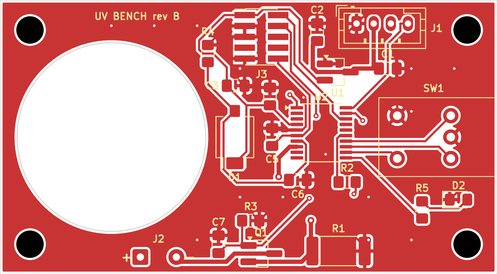
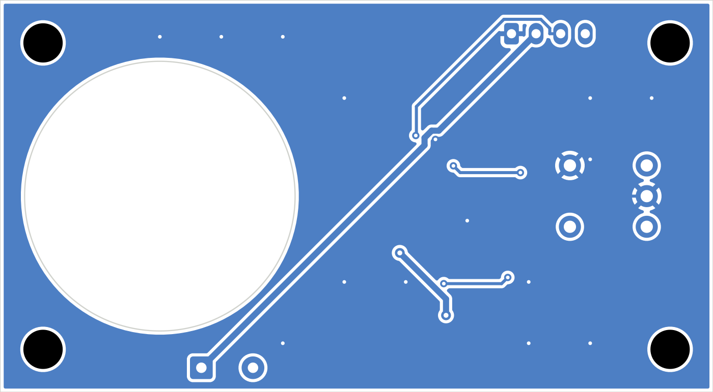
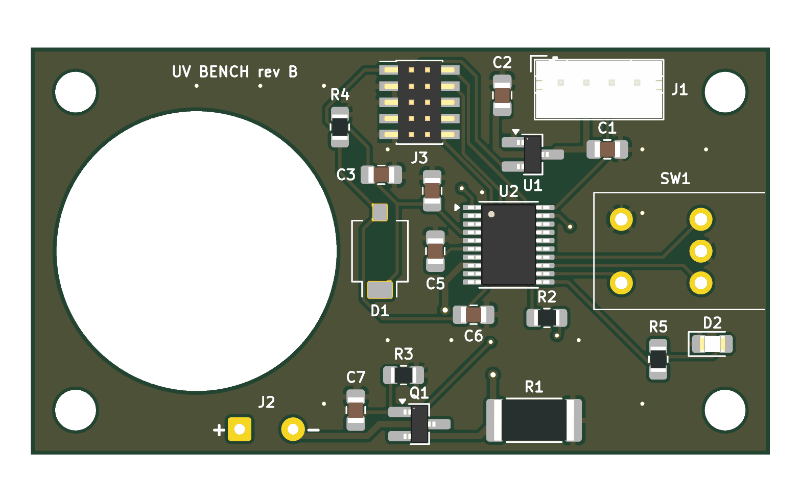

# UV bench, Rev B/C: the simple version

Status: **Rev B approved 2026-10-13, schematic and PCB done in KiCad** (§8).
**Rev C (2026-10-15) = Rev B + an optional remote photodiode** on a 50 cm cable (block 8, J4)
and its small sensor-head board (`hardware/pd-head/`). Everything else is unchanged. Rev B was
never fabricated; it stays in the git history (commit 9fdfe87). It replaces the Rev A
circuit (71 parts, 9 ICs, 4 schematic sheets), which is archived in
[`hardware/archive/rev-a/`](../hardware/archive/rev-a/).

KiCad project: [`hardware/uv-bench/uv-bench.kicad_pro`](../hardware/uv-bench/uv-bench.kicad_pro).
Generated parts list with nets: [`parts-list.md`](parts-list.md).

**Goal.** A UV LED whose light output is held constant by a photodiode and a microcontroller.
An external board sets it over I2C. The board is small, simple, and easy to solder by hand.

**Result:** **26 parts on the board, in 16 part types** (Rev B: 21 in 14), including the
connectors. Only **4 resistor values** (plus one power resistor) and **2 capacitor values**.

---

## 1. The idea in one picture

```
            5 V ───────────────┬───────────────► LED+ ──[ARM switch]──► UV LED ──► LED−
   I2C  ──┐                    │                                                  │
 board    │   ┌─────────┐      │                                                  ▼ drain
 (J1)     └──►│   MCU   │ PWM  │   ┌───────────┐  gate voltage  ┌──────────┐
   SDA/SCL    │ STM32C0 ├─────────►│ RC filter ├───────────────►│ MOSFET Q1│  current
              │         │          └───────────┘                └────┬─────┘  set here
              │         │◄── I_MON (current, for monitoring) ────────┤ source
              │         │                                            R1 3.9 Ω
              │         │                                            ▼ GND
              │         │◄── PD voltage ◄── [R + C] ◄── photodiode ◄~~~ a little UV light
              └─────────┘
```

**How it works:**

1. The MCU outputs a PWM signal.
2. An RC filter turns the PWM into a smooth DC voltage, from 0 to 3.3 V.
3. That voltage drives the MOSFET gate. The MOSFET and R1 set the LED current: more gate
   voltage gives more current.
4. A photodiode sees a small, fixed fraction of the LED light. It produces a current
   proportional to the light, and a resistor turns that current into a voltage.
5. The MCU reads that voltage and adjusts the PWM until it equals the setpoint. This is the
   **feedback loop**, and it runs in firmware.

**The key simplification.** In Rev A an op-amp loop held the LED **current** exactly, and the
MCU loop then held the **light**: two loops in cascade. Rev B has only the light loop.

- The MOSFET alone gives an imprecise current, which drifts with temperature.
- That doesn't matter, because the photodiode loop corrects any drift, whatever its cause:
  MOSFET, LED ageing or LED temperature.
- So the op-amp, its switch, its compensation parts and the AND gate all disappear.

---

## 2. The blocks, one by one

### Block 1: Power input (J1, C1, C2)

```
 J1 (JST-PH 4)                       5V
  1 GND ──────────────┬──────┬────────── GND
  2 +5V ──────────────┼──────┼──┬────── 5V  (to the LED and to the regulator)
  3 SDA ─► MCU        │     C1  C2  10 µF + 10 µF
  4 SCL ─► MCU       GND    GND GND
```

- **What it does:**
  - Brings in 5 V and the two I2C wires from the external board.
  - Uses the same connector and pinout as before, per the interface spec: GND, 5V, SDA, SCL.
- **Why it's this simple:**
  - The LED current is now **DC**: no dark gaps and no PWM on the LED.
  - So the cable carries a steady current, and two 10 µF ceramic capacitors are enough to
    absorb the fast noise.
  - Rev A needed 220 µF and an LC filter because its LED current had steps.
  - The JST-PH connector is keyed, so it can't be plugged in reversed. That's why there is no
    reverse-polarity diode.
- **Removed from Rev A:**
  - The second 5 V input (FTDI) and its ideal diodes U1/U2.
  - The PTC fuse, the TVS surge diode and the ferrite bead.
  - Those mattered with two power sources. With one source, the main board's own supply
    protection covers us.

### Block 2: 3.3 V regulator (U1, C3)

```
 5V ──► [U1 MCP1700-3.3] ──► 3V3 ──┬── to MCU, photodiode
             │                     C3 10 µF
            GND                    GND
```

- **What it does:** turns 5 V into 3.3 V for the MCU. The STM32 is rated 2.0–3.6 V, so it
  can't take 5 V directly.
- **Why an LDO** (*low-dropout linear regulator*):
  - The MCU draws ~5 mA, so the regulator only burns (5 − 3.3) × 5 mA ≈ 9 mW.
  - A switching regulator would be pointless here.
  - The MCP1700 has 3 pins, comes in SOT-23 (easy to solder), and needs only one ceramic
    capacitor at its input and one at its output.
- **C1/C2 double as its input capacitor,** if they sit within ~10 mm of it.
- **3.3 V is also the ADC reference** (VDDA = VDD on this MCU). So the photodiode reading is
  a ratio to 3.3 V, and a drift of the LDO shifts the regulated light by the same ratio.
  - The MCP1700 is ±0.4 % at 25 °C, a few tenths of a percent over the bench temperature range.
  - If that is ever too much, the firmware can correct it with the MCU's internal reference
    (VREFINT). That costs no extra parts.

### Block 3: Microcontroller (U2, C4, C5)

**STM32C031F6P6, TSSOP-20**, the same MCU as in Rev A.

| Pin | Port | Use | Net |
|---|---|---|---|
| 4 | VDD | Supply + ADC reference | 3V3, with C4 100 nF right at the pin |
| 5 | VSS | Ground | GND |
| 6 | NRST | Reset | C5 100 nF to GND, and to the debug header |
| 7 | PA0 | ADC input | PD (photodiode voltage) |
| 8 | PA1 | ADC input | I_MON (LED current) |
| 9 / 10 | PA2 / PA3 | USART2 TX / RX | UART_TX / UART_RX, to the debug header (ST-LINK virtual COM port) |
| 11 | PA4 | GPIO output | MODE_LED (green LED: on = I2C mode) |
| 12 | PA5 | GPIO input, pull-up, EXTI | BTN (knob push) |
| 13 / 14 | PA6 / PA7 | TIM3_CH1 / CH2, encoder mode, pull-ups | ENC_A / ENC_B (knob rotation) |
| 15 | PA8 | TIM1_CH1 PWM | PWM (LED drive) |
| 17 | PA12 (shares the pin with PA10) | ADC input (ADC1_IN12) | ADC_EXT_PD (remote photodiode, Rev C) |
| 18 / 19 | PA13 / PA14 | SWDIO / SWCLK | Debug header |
| 20 / 1 | PB6 / PB7 | I2C1 SCL / SDA | J1 |
| others | | not connected | |

- **Why a local MCU, and not just I2C chips** (a DAC plus an ADC): the loop runs **on the
  board**.
  - The external board only says "hold 120 mW" and reads back the status.
  - If the I2C cable or the main board hangs, the bench still regulates, and it can turn the
    LED off by itself.
- **C4** is the decoupling capacitor:
  - The MCU draws current in short spikes on each clock edge.
  - A 100 nF capacitor at the pin supplies those spikes, so the 3.3 V rail stays clean.
  - Rule: one 100 nF per supply pin, as close as possible.
- **C5 on NRST** filters noise, so a spike can't reset the MCU. ST recommends it.
- **No remapped pins:** every function sits on a pad's default port. That's simpler in
  CubeMX than the PA9/PA12 remaps of Rev A.

### Block 4: LED driver (Q1, R1, R2, R3, C7)

This is the heart of the board: a **voltage-controlled current sink**.

```
          5V ──► LED+ ──[ARM switch]──► UV LED ──► LED−
                                                    │ drain
 PA8 PWM ──[R2 1 kΩ]──┬────────────────────────── gate Q1 AO3400A
                      │                             │ source
                    C7 10 µF   R3 100 kΩ            ├──────► PA1 (I_MON)
                      │           │                R1 3.9 Ω, 1 W
                     GND         GND               GND
```

**1. The RC filter (R2, C7) turns PWM into DC.**

- PA8 switches between 0 and 3.3 V at 20 kHz. The duty cycle *D* is set by the firmware.
- R2 and C7 average it to *D* × 3.3 V.
- Time constant: τ ≈ R2·C7 = 1 kΩ × 10 µF = **10 ms**.
- Residual ripple ≈ 3.3 V × D(1−D) × T/τ ≤ 3.3 × 0.25 × 50 µs / 10 ms ≈ **4 mV peak-to-peak** at worst.
- On the LED current that is ~1 mA out of 300 mA (0.3 %). The light is effectively DC.
- Resolution: the 48 MHz timer at 20 kHz gives 2400 steps, i.e. 11 bits. 20 kHz is above
  hearing, so the capacitors don't sing.

**2. R3 is a safety pull-down.**

- During reset, or while the debugger holds the MCU, PA8 floats.
- R3 then discharges C7 so the LED fades out (τ = 100 kΩ × 10 µF ≈ 1 s) and stays off.
- In normal use the firmware drives PA8 low to switch off, which takes ~10 ms.
- R3 costs a little gate voltage: 3.3 V × 100/101 = 3.27 V maximum.

**3. Q1 and R1 set the current.**

- Q1 works as a **source follower**: its source sits about V_GS below its gate.
- So the voltage across R1 is V_gate − V_GS, and the LED current is
  **I = (V_gate − V_GS) / R1**.
- **What R1 does:**
  - It makes the current depend mostly on the gate voltage, not on Q1's exact threshold.
    That is called *source degeneration*.
  - It also gives the MCU a free current measurement: **I_MON = I × 3.9 Ω**, read on PA1.
- V_GS (~1.3–1.8 V at 0.3 A for this MOSFET) changes from part to part and with temperature.
  That's acceptable here, because the photodiode loop removes the error.

**What happens as the duty cycle rises** (calculated for a typical AO3400A, V_th ≈ 1.0 V, and
an LED with V_f ≈ 3.7 V; your parts will differ, and the loop doesn't care):

| PWM duty | V_gate | LED current | V across R1 (I_MON) | V across Q1 | Q1 heat | Region |
|---|---|---|---|---|---|---|
| 0–30 % | 0–1.0 V | 0 | 0 | 1.3 V | 0 | Off: gate below threshold (the "dead zone") |
| 40 % | 1.31 V | 35 mA | 0.14 V | 1.16 V | 41 mW | Regulating |
| 50 % | 1.63 V | 92 mA | 0.36 V | 0.94 V | 87 mW | Regulating |
| 60 % | 1.96 V | 155 mA | 0.61 V | 0.69 V | 108 mW | Regulating (Q1 warmest) |
| 70 % | 2.29 V | 221 mA | 0.86 V | 0.44 V | 97 mW | Regulating |
| 80 % | 2.61 V | 290 mA | 1.13 V | 0.17 V | 49 mW | Regulating, nearly fully on |
| 90–100 % | ≥ 2.9 V | **333 mA** | 1.30 V | ~0 | ~0 | Fully on: current limited by R1 + LED |

The 1.3 V "budget" is 5 V − V_f(LED). It is shared between R1 and Q1: Q1 absorbs whatever
R1 doesn't need. When Q1's share reaches zero, the current can't rise any more.

**4. Hardware current limit, for free.**

- At full drive Q1 is fully on, and nothing but R1 and the LED limits the current:
  **I_max = (5 V − V_f) / 3.9 Ω**.
- So a firmware bug can never overdrive the LED. It can only turn it fully on.

| LED V_f at 0.3 A | 3.4 V | 3.7 V (typical) | 4.0 V |
|---|---|---|---|
| I_max | 0.41 A | **0.33 A** | 0.26 A |

- **Check the actual LED** at bring-up: measure V_f, then pick R1 (3.3 / 3.9 / 4.7 Ω) for ~0.33 A.
- **Heat:**
  - R1 dissipates I²R = 0.33² × 3.9 ≈ **0.43 W**. A 2512 1 W resistor gives a ×2 margin. Keep
    it away from the photodiode.
  - Q1 dissipates the most at mid-current: I × (5 − V_f − I·R1), at most ≈ **0.16 W**. In
    SOT-23 with a little copper that is about +30 °C. So there's no heatsink and no thermal
    vias.
- **Why the AO3400A:**
  - A *logic-level* N-MOSFET: fully on with only 2.5 V on the gate, which the 3.3 V MCU can
    deliver.
  - 30 V, 5.7 A, SOT-23, about €0.05.
  - Rev A's NDT3055L needed an op-amp and a heatsink zone.

**Removed from Rev A:**

- The OPA2388 op-amp (both halves), the 2-stage PWM filter and the 74LVC1G66 switch.
- The 74LVC1G08 AND gate, the gate resistor and the compensation network.
- The 0.33 Ω Kelvin sense, the drain and input voltage dividers, and the Q1 heatsink copper.

### Block 5: Photodiode sensor (D1, R4, C6)

```
 3V3 ──► D1 cathode
         D1 SFH 2401 (photodiode, reverse-biased)
         D1 anode ──┬──────┬──────► PA0 (ADC)
                    R4     C6
                  100 kΩ  100 nF
                    │      │
                   GND    GND
```

- **What it does:** converts light into a voltage.
  - The photodiode is **reverse-biased**: cathode to +3.3 V.
  - Light creates a current proportional to the optical power, about 0.1 A/W at 365 nm.
  - That current flows through R4: **V = I_pd × 100 kΩ**. For example, 10 µA gives 1.0 V.
- **Why a resistor instead of Rev A's transimpedance amplifier (TIA):**
  - A TIA is needed for fast signals, or when the photodiode must stay at 0 V.
  - Rev A needed both, for its 50 µs dark-gap samples.
  - Rev B's light is DC, so a plain resistor is enough, and it removes an op-amp and two
    precision parts.
  - The reverse bias also helps: it keeps the photodiode linear as long as V stays below
    ~3.0 V, leaving ≥ 0.3 V across the diode.
- **C6** filters the signal (τ = R4·C6 = 10 ms). It also serves as the ADC's charge reservoir:
  the STM32 ADC samples into a few pF, and C6 supplies that charge without a dip.
- **Choosing R4 is choosing the gain.**
  - Target: **5–25 µA** of photocurrent, i.e. 0.5–2.5 V.
  - The Rev A optics (pinhole 0.5–1 mm onto a PTFE spot) gave only 0.5–2 µA, which is too
    little for 100 kΩ.
  - So **open the pinhole to ~2–3 mm**: the area grows by ×4 to ×36.
  - Or, if the light stays weak, change R4 to 1 MΩ. The loop then gets 10× slower, which is
    still fine.
- **Ambient light:**
  - The dark chamber keeps room light out.
  - At each switch-on, the firmware also reads PA0 with the LED still off (the "dark"
    reading), and then subtracts it.
  - There is no more synchronous on/off sampling during operation.

### Block 7: User controls (SW1, D2, R5)

```
            +-----------------+
 PA6 ENC_A -| A    rotary     |
 PA7 ENC_B -| B    encoder  S1|- PA5 BTN    (push the knob)
      GND --| C    PEC09    S2|- GND
            +-----------------+
 PA4 MODE_LED --[R5 1 kΩ]--► D2 green ──► GND
```

- **What it does:** a knob to set the light by hand, independently of the I2C board.
  - **Turn** the knob to change the power: in manual mode, each click steps the setpoint up
    or down.
  - **Short push:** toggle between **I2C mode** (green LED **on**, knob ignored) and **manual
    mode** (green LED off, the I2C board's setpoint is ignored).
  - **Long push** (> 1 s): reserved for a later firmware function, e.g. LED on/off, or "save
    this power as the default".
- **Why a rotary encoder and not a potentiometer.** An encoder sends pulses ("one click
  left/right") instead of an absolute position. So when you switch from I2C to manual, the
  power **stays where it was** and the knob adjusts from there. A potentiometer would jump to
  wherever the knob happens to point. It also includes the push button: one part, 3 pins.
- **How the encoder works:** inside are two contacts, A and B, that close in turn as the shaft
  rotates, 90° out of phase (*quadrature*). Which one closes first gives the direction. C is
  their common contact, wired to GND. S1–S2 is the push switch.
- **No extra resistors or capacitors:**
  - The MCU's internal pull-ups (~40 kΩ) hold the pins high when the contacts are open.
  - Mechanical contacts *bounce* (they open and close several times in ~1 ms). On A/B this is
    handled by **TIM3 in encoder mode**: the timer counts the quadrature edges in hardware, and
    its input filter ignores short glitches. A bounce on one channel only moves the count back
    and forth by one, and the firmware reads clicks (4 counts).
  - The button is debounced in firmware: it is accepted when stable for 20 ms.
  - This is a firmware-versus-hardware trade: Bourns' datasheet shows an RC filter
    (10 kΩ / 10 nF) per line, which would add 6 parts and 2 new values.
- **The green LED is a pure firmware indicator.** R5 = (3.3 − 2.0 V) / 1.3 mA ≈ 1 kΩ, the
  same value as R2.
- **Mechanics:** the PEC09 is a 9 mm encoder with a horizontal shaft. It sits at the right
  edge of the board, and the shaft sticks out through the side of the housing. A small knob,
  about 12–15 mm in diameter, is comfortable for a finger. The green LED sits just below it.

### Block 6: Debug port (J3)

**ST's 14-pin STDC14 header** (2×7, 1.27 mm, keyed: Samtec FTSH-107-01-L-DV-K), the connector
at the end of the STLINK-V3MINIE's own cable. Its pins:

| Pin | Signal | Net |
|---|---|---|
| 1, 2 | not connected inside the probe | — |
| 3 | VCC (the probe reads the target voltage here to set its levels) | 3V3 |
| 4 / 6 | SWDIO / SWCLK | PA13 / PA14 |
| 5, 7, 11 | GND (11 = *GNDDetect*) | GND |
| 8, 9, 10 | SWO, JRCLK, JTDI: JTAG only, not on a Cortex-M0+ | — |
| 12 | RST | NRST |
| 13 | VCP_RX: the probe **receives** here | UART_TX (PA2) |
| 14 | VCP_TX: the probe **sends** here | UART_RX (PA3) |

- **SWD** (*Serial Wire Debug*) is how you flash and debug the STM32 from CubeIDE.
- **Why 14 pins and not the classic 2×5** (changed 2026-10-14): the V3MINIE ships with a 14-pin
  cable. Pins 3–12 are exactly the ARM 10-pin layout, so a 10-pin header *can* take it, but
  only unkeyed and centred by eye. The 14-pin header is keyed: it can't go in shifted or
  reversed. It costs 2.5 mm of board and €1.20 more.
- **The bonus, pins 13–14:** a UART that the probe passes to the PC over the same USB cable
  (a "virtual COM port", `/dev/ttyACM0` on Linux). With USART2 on PA2/PA3, the firmware can
  `printf` debug messages to a terminal with no extra cable or part. PA2/PA3 were spare pins.
- **TX goes to RX:** the names on the header are the probe's. The MCU's TX (PA2) goes to the
  probe's receive pin (13).
- **Layout:** the UART nets are in the `Noisy` net class, like PWM, so DRC keeps them 0.5 mm
  from the photodiode track (they switch only while a message is being sent).

### Block 8: Remote photodiode (J4, R6, R7, R8, C8), Rev C, optional

**What for.** D1 watches the LED through the housing, so it regulates the *lamp*. A second
photodiode lying **on the target**, under the same ZWB2 filter as the lamp, measures what the
sample actually receives: the irradiance in mW/cm². The firmware can regulate on it (CTRL bit
FB_EXT, interface-spec v2.3) or just report it (MEAS_EXT_PD_RAW), so the main board can regulate
in software.

```
 sensor head (50 cm twisted pair)      main board
   K ─────────────── J4.1 ── R6 1k ── +3V3          bias, current limit if the cable shorts
  SFH 2401
   A ─────────────── J4.2 ──┬── R7 1k ── PA12 (ADC1_IN12)
                            ├── R8 10k ── GND       load: V = I × 10 k
                            └── C8 100n ── GND      τ = 1 ms, ESD charge sink
```

**Is there enough signal without an amplifier? Yes, by far.** A photodiode is a current
source: I = E × A × R_λ.

- A = 7 mm² = 0.07 cm², R_λ ≈ 0.1 A/W at 365 nm, the filter passes ~80 %:
  **≈ 5.6 µA per mW/cm²**.
- The lamp (~0.3–0.4 W of UV) gives roughly 1–50 mW/cm² on a target a few cm away:
  **5–300 µA**.
- With R8 = 10 k that is 0.06–2.8 V, i.e. 70 to 3500 ADC counts. An amplifier is for nW–µW
  signals (pA–nA, MΩ–GΩ loads); a sensor sitting *in* the beam has the opposite problem:
  don't saturate. R8 = 100 k (like R4) would saturate above ~5 mW/cm².
- **R8 is a first guess.** Measure, then re-stuff it if the reading saturates (smaller R) or
  stays below ~200 counts (larger R). Keep the voltage under ~2.5 V so the diode stays reverse
  biased (3.3 V minus the drop on R6).

**Why the load is on the main board, not on the head.** The cable then carries a *current*.
Noise picked up along the cable or the board tracks is injected into R8 ∥ C8, which is only
~80 Ω at 20 kHz: a 0.1 pF stray coupling from a 3.3 V edge moves it by 3.3 V × 0.1 pF / 100 nF ≈
3 µV. Twist the two wires anyway (it cancels mains pickup), and the firmware averages over
20 ms (one 50 Hz period).

**Protection, since the cable gets plugged, unplugged and maybe pinched:**
- **R6 1 k** in the bias: a short in the cable draws 3.3 mA instead of pulling down the MCU
  supply. It costs 0.3 V at 300 µA: harmless.
- **R7 1 k + C8:** an ESD discharge on the connector lands in C8, and R7 limits the current into
  the MCU pin.
- **Unplugged:** R8 pulls the input to 0 V. The firmware sees "no light" and the safety rule
  "remote feedback lost" (interface-spec §5) turns the LED off if it was regulating on it.

**Why PA12 (pin 17) and not PA11 (pin 16).** Both are free ADC inputs. Pin 16 sits right next to
pin 15, the PWM; pin 17 sits next to SWDIO, which is quiet except while debugging. In CubeMX,
select **PA12**: it shares pin 17 with PA10 and CubeMX sets the remap bit.

**The filter passes infrared.** ZWB2 (Wood's) glass blocks the visible but transmits near-IR
above ~700 nm, where silicon is most sensitive. Sunlight and incandescent or halogen lamps add an
offset; LED and fluorescent room light add little. The dark reading taken at each switch-on is
subtracted, and a dim enclosure removes the rest.

**The sensor head** (`hardware/pd-head/`, 12 × 21 mm, 2-layer, its own Gerbers):
- An SFH 2401 (the same part as D1), sensitive face up, and two wire pads with strain-relief
  holes: thread each wire through the big hole first, then solder it in the small one.
- Wire pad **K** (square pad, "K" on the silkscreen; it joins the diode's large pad, the cathode) goes to **J4 pin 1**, pad **A** to
  **J4 pin 2**. The back silkscreen repeats it.
- Put the ZWB2 filter directly over the diode (a drop of clear glue at the edges, or a printed
  cap). The light reaching the diode through the filter is what the calibration measures, so
  the filter must not move relative to the diode.
- Regulating on the head holds *the head's* reading constant. If the head moves or is shaded,
  the LED follows it, up to SETPOINT_CURRENT. Keep the head beside the sample, at the same
  height, and set SETPOINT_CURRENT to a sensible limit.

### Mechanical assembly: how the LED fits in the hole

The LED is **not soldered to this board**. It comes on its own 20 mm aluminium disc (the
"star", from the Convoy S2), which is screwed to an aluminium plate. The PCB stands **above the
plate on 4 standoffs**, and the star sits inside the Ø 22 mm hole, with 1 mm of air all around.

```
                 ZWB2 window (housing lid)
   ════════════════════════════════════════════
                ╲     reflector      ╱
     cap ┌──┐    ╲                  ╱
         │D1│     ╲   ┌───────┐    ╱
   PCB ══╧══╧══════╲══│  LED  │═══╱═══════ J2 ─ 2 wires to the star pads
         standoff ▐   [ 20 mm star ] ▐ standoff
   ════════════════════════════════════════════  aluminium plate, 3 mm (heatsink + base)
          ◄──── Ø 22 mm hole in the PCB ────►
```

**Assembly:**

1. Put a little thermal paste under the star, and screw it to the plate. Use the star's own
   holes, or glue it with thermal adhesive.
2. Screw 4 M3 standoffs to the plate.
   - Choose their height so the PCB's top surface is level with, or just below, the LED.
   - For example, about 2–3 mm for a 1.6 mm star. Measure yours.
3. Put the PCB on the standoffs, with the star in the hole. Screw it down.
4. Solder two short wires from the star's + and − pads to **J2**: the square pad, marked **+**,
   is LED+.
   - The ARM switch goes in series with the + wire.
5. Put the reflector over the LED, and the black cap over D1.

**Why it is done this way, instead of soldering the LED onto the PCB:**

- **Heat.**
  - The LED dissipates ~1 W into a few mm². That needs metal under it; FR4 (the PCB material)
    conducts heat ~1000× worse than aluminium.
  - The plate takes the heat, and the air gap keeps it away from the photodiode, whose
    sensitivity drifts with temperature.
- **Fixed geometry.** The plate, the standoffs and the PCB form one rigid part. The LED-to-
  photodiode distance can't change, so the fraction of light the photodiode sees stays
  constant. That's what makes the regulation meaningful.
- **Replaceable LED:** unsolder 2 wires, unscrew the star.

### Off board: LED head and UV ARM switch

```
 board pad LED+ ──► ARM switch (toggle, on the housing) ──► star LED+
 board pad LED− ◄────────────────────────────────────────── star LED−
```

- **J2** is two solder pads for the LED wires.
- **The LED star** is the LG 365 nm star from the Convoy S2, in the Ø 22 mm cut-out (option B).
  It is screwed to its aluminium plate.
- **The ARM switch:**
  - It is a mini toggle switch in the **LED+ wire**, mounted on the housing.
  - In OFF the LED is physically disconnected, whatever the MCU or Q1 does. That holds even
    if Q1 fails as a short, which is the usual failure mode of a MOSFET.
  - Rating: ≥ 0.5 A DC. Any standard mini toggle switch (MTS-102 class, rated several A) is
    plenty.
- **How the firmware knows the switch is OFF:** when it drives the LED, I_MON stays at zero.
  That sets STATUS.ARM_OFF, with no extra wire.

---

## 3. Parts list

| Ref | Part | Value / MPN | Footprint (hand-solder) | Qty |
|---|---|---|---|---|
| J1 | Connector | JST-PH 4-pin, top entry (B4B-PH-K-S) | THT | 1 |
| J2 | Wire pads | LED+ / LED− | 2 pads | 1 |
| J3 | Debug header | STDC14 2×7 1.27 mm, keyed: Samtec FTSH-107-01-L-DV-K | SMD | 1 |
| J4 | Connector, remote photodiode (Rev C) | JST-PH 2-pin, top entry (B2B-PH-K-S) | THT | 1 |
| U1 | LDO 3.3 V | MCP1700T-3302E/TT | SOT-23 | 1 |
| U2 | MCU | STM32C031F6P6 | TSSOP-20 | 1 |
| Q1 | N-MOSFET, logic level | AO3400A | SOT-23 | 1 |
| D1 | Photodiode | ams OSRAM SFH 2401 (replaces the discontinued BPW 34 BS, same pads) | SMD | 1 |
| D2 | LED, green (mode) | any 0805 green | 0805 | 1 |
| SW1 | Rotary encoder with push switch | Bourns PEC09-2xxxF-Sxxxx (pick the shaft length) | THT | 1 |
| R1 | Resistor, power | **3.9 Ω**, 1 W | 2512 | 1 |
| R2, R5, R6, R7 | Resistor | **1 kΩ** | 0805 | 4 |
| R8 | Resistor (remote PD load; adjust after measuring) | **10 kΩ** | 0805 | 1 |
| R3, R4 | Resistor | **100 kΩ** | 0805 | 2 |
| C1, C2, C3, C7 | Capacitor, X5R/X7R ≥ 10 V | **10 µF** | 0805 | 4 |
| C4, C5, C6, C8 | Capacitor, X7R | **100 nF** | 0805 | 4 |
| *off board* | UV LED star, ARM toggle switch, wires | | | |

**Totals:**

- **26 parts on the board, in 16 types** (Rev B: 21 in 14). Without block 8: leave J4, R6–R8,
  C8 empty; the rest works unchanged.
- **Values to buy:** 4 resistors (3.9 Ω, 1 kΩ, 10 kΩ, 100 kΩ) and 2 capacitors (100 nF, 10 µF).
- **Sensor head:** 1 SFH 2401 on its own small PCB, plus the cable (block 8).
- **Order spares** of the 0805 parts, ~10 of each: they jump off the tweezers.

**Soldering order** (lowest parts first, the hardest one while you're fresh):

1. U2, the TSSOP-20.
2. U1, Q1.
3. The passives.
4. D1, D2.
5. J3, J1, J4, SW1.

**Board size:** **58 × 32 mm**, the Ø 22 mm cut-out included (Rev A: 70 × 55 mm).

---

## 4. Power budget

| Load | Current from 5 V |
|---|---|
| LED (maximum) | 0.33 A typical, 0.41 A worst case (low V_f) |
| MCU + LDO + mode LED | ~7 mA |
| **Total** | **≈ 0.34 A** (≤ 0.4 A from the interface spec; worst case at the limit) |

**Where the 1.6 W goes:** LED ~1.2 W (into its plate), R1 0.43 W, Q1 ≤ 0.16 W.

---

## 5. Firmware: the control loop

Run every 1 ms (a timer interrupt):

```c
pd   = adc_read(PA0) - pd_dark;       // light, ambient removed
err  = setpoint - pd;
duty = duty + KI * err;               // integral controller
duty = clamp(duty, 0, DUTY_MAX);
pwm_set(duty);
locked    = fabsf(err) < 0.01f * setpoint;
saturated = (duty == DUTY_MAX) && (err > 0);   // asks for more light than available
arm_off   = (duty > DUTY_ON) && (adc_read(PA1) < I_MIN);
```

- **Why integral only:** the plant is two slow first-order filters (gate RC and photodiode
  RC, 10 ms each).
  - An integrator alone reaches zero steady-state error, and it is stable if the loop stays
    well below ~16 Hz.
  - Start with a crossover around 2 Hz: settling ≈ 0.3 s. Tune KI on the bench.
- **The nonlinearity doesn't matter:** for example the dead zone below V_GS, where the LED is
  still off. The integrator simply walks through it.
- **Soft start is built in:** with a modest KI the light ramps up instead of jumping.

**Mode handling** (main loop, not time-critical):

```c
clicks = (int16_t)(TIM3->CNT - last_cnt) / 4;  // TIM3 counts 4 edges per click
last_cnt += clicks * 4;
if (button_released_after(20, 1000))  mode ^= 1;          // short push: toggle I2C / MANUAL
if (button_held_for(1000))            long_push_action();  // reserved
gpio_write(MODE_LED, mode == MODE_I2C);                   // green = I2C in control
if (mode == MODE_MANUAL) setpoint = clamp(setpoint + clicks * STEP, 0, SP_MAX);
else                     setpoint = i2c_setpoint;         // knob ignored
```

The setpoint is shared, so switching modes never makes the light jump.

---

## 6. What changed for the rest of the project

- **Interface spec → [v2.1](interface-spec.md)** (done; v2.1 adds STATUS.MANUAL for the knob):
  - **Unchanged:** the connector, address 0x2A and the register map structure.
  - **Removed:** MEAS_T_LED, MEAS_V_HEADROOM, MEAS_V_IN, OVERTEMP and T_LIMIT (no NTC or
    dividers).
  - **ARM_OFF** is now detected from I_MON.
  - **Address:** fixed at 0x2A. JP1 is removed (the address can still be changed in flash).
  - **UART console:** removed (no FTDI header). For PC control, use the main board, a Nucleo or
    a USB-I2C adapter.
- **I2C pull-ups:** still on the controller board (4.7 kΩ), as the spec says. For a bench test
  with a Nucleo on short wires (< 20 cm, 100 kHz), its internal pull-ups usually work.
- **KiCad:** one wired schematic sheet, a 58 × 32 mm board (§8).
- **Simulation:** one ngspice run of Block 4 (PWM → RC → MOSFET → LED current, ripple and
  step response) replaces S2 and S4.

## 7. Rev A vs Rev B

| | Rev A | Rev B |
|---|---|---|
| Parts on board | 71 (+ 13 test points) | **21** (knob included) |
| ICs | 9 | **2** (LDO, MCU) |
| Resistor / capacitor values | 11 / 9 | **3 + 1 power / 2** |
| Schematic sheets | 4 | **1** |
| Board | 70 × 55 mm | **58 × 32 mm** |
| LED current | Precise, op-amp loop + light loop | Set by MOSFET + R1, light loop only |
| Light | DC with 50 µs dark gaps | DC |
| Monitoring | Current, light, temperature, headroom, V_in | Current, light |
| Extra interfaces | UART header, 2nd 5 V input, address jumper | — |

**What you lose:**

- Temperature and voltage monitoring.
- Continuous ambient rejection.
- A UART console.
- A hardware current loop. A current mode still exists, but in firmware: the same integrator,
  fed from I_MON instead of the photodiode (interface spec v2.0, MODE 0). It is slower, ~0.3 s,
  but just as exact at DC.

None of these is needed for "a UV LED held at constant power, set over I2C".

---

## 8. The KiCad implementation

### 8.1 Schematic: one A4 sheet



**The seven blocks from §2 are drawn in signal order, each with a caption:** power input,
regulator, debug port and MCU along the top, the user controls below the MCU, then the LED
driver and the photodiode on the right.

- **Real wires inside each block.** Net labels are used only where a signal goes from one block
  to another: SDA/SCL, SWDIO/SWCLK, PWM, I_MON and PD.
- **A label with the same name is the same wire.** That's the KiCad convention, and it's why the
  MCU's right-hand pins carry labels instead of long wires.
- **Power symbols** (GND, +3V3, +5V) are global connections too.
- **PWR_FLAG** on +5V and GND tells ERC that these nets are driven by something outside the
  board, here the cable.
- **Every unused MCU pin has a no-connect flag (×).** It says "unconnected on purpose", so ERC
  doesn't report it.

**How it was made:**

- `hardware/gen/design.py` says *what* the circuit is: parts, values and pin-to-net map.
- `layout.py` says *how* it is drawn: where each part sits and the wire paths.
- `gen_sch.py` writes the `.kicad_sch` file.
- It then asks kicad-cli for the netlist that KiCad itself reads from the drawing, and compares
  it pin by pin with `design.py`. That's how a drawing mistake (a wire touching the wrong pin) is
  caught before it reaches the PCB.

### 8.2 PCB: 58 × 32 mm, 2 layers

| Top copper | Bottom copper |
|---|---|
|  |  |



**Placement** (`hardware/gen/placement.py`). Each choice has a reason:

| Part | Where | Why |
|---|---|---|
| Cut-out Ø 22 mm | Left half | The LED star sits on its aluminium plate *under* the board, and its light comes up through the hole (option B) |
| D1 photodiode | Right edge of the cut-out, 14.4 mm from the LED axis | Looks at the PTFE scatter spot through the housing's side port. The geometry is fixed by the board, so the sampled fraction can't drift |
| J2 LED pads | Under the cut-out, marked **+** and **−** | Two short wires to the star. Pad 1 (square, +) = +5V, pad 2 = drain |
| Q1, R1 | Bottom edge, ~13 mm from D1 | R1 dissipates up to 0.43 W. Keeping it away from the photodiode avoids heating D1 (its responsivity drifts with temperature) |
| U2 MCU | Centre | Equal distance to everything it talks to |
| J3 debug (STDC14) | Top edge | The debug cable comes from outside |
| SW1 knob | Right edge, shaft pointing outwards | Reachable through the housing side; far from the LED's reflector |
| D2 mode LED | Just below the knob | You see the mode where your finger is |
| J1 JST-PH | Top edge | The cable leaves the board upwards, away from the knob |
| J4 JST-PH 2 (Rev C) | Top edge, between the cut-out and J3 | The only free edge spot; on the analog side of the board, away from R1 and Q1. R8/C8 sit beside it, R7 next to the MCU |
| U1 LDO | Just below J1 | Short path from the 5 V input |
| Small parts | Auto-placed, as close as possible to the pin they serve | Decoupling C4 at VDD, filter C6 at the ADC pin, C7/R3 at the MOSFET gate |

**Routing** (`route.py`, Freerouting autorouter):

- **Net classes** (Board Setup → Net Classes):
  - *Power*: +5V, LED_K and I_MON carry the LED current. They are 0.5 mm wide, which carries
    over 1 A on 1 oz copper with a negligible temperature rise.
  - *Analog*: PD.
  - *Noisy*: PWM, UART_TX, UART_RX (pattern `UART_*`).
  - *Default* (0.25 mm): everything else.
- **One custom rule, which you can see in Board Setup → Custom Rules:** PD tracks keep **0.5 mm
  from the *Noisy* tracks** (PWM and the debug UART).
  - PWM is the only signal that switches all the time: 3.3 V edges at 20 kHz. The UART
    switches only while a debug message is sent, but it's the same kind of 3.3 V edge.
  - The PD node is 100 kΩ, so a few fF of coupling capacitance would inject spikes into it.
  - Rev A's rule ("analog away from power") made sense there, because its LED current switched
    in 50 µs gaps. In Rev B the LED current is DC, so it was replaced.
  - That's a good example of a rule that must follow the circuit, not habit.
- **GND pour** on both layers, with stitching vias every 5 mm. This makes a low-impedance ground
  everywhere, and the return current of each signal flows right under its track.
- **Keepouts:**
  - A 0.8 mm ring around the cut-out.
  - A 0.5 mm strip along the edges.
  - They are needed because the autorouter doesn't know KiCad's copper-to-edge rule.
- **Clean-up:** Freerouting sometimes leaves "spurs": a segment that goes out and comes back,
  ending nowhere. `route.py` removes them, otherwise DRC would report them as `track_dangling`.

**Checks:** `tools/kicad-check.sh` runs these, then exports the Gerbers, drill files and
`gerbers.zip` for JLCPCB:

- ERC: 0 violations.
- DRC: 0 violations, 0 unconnected.
- Schematic ↔ PCB parity: 0 issues.

### 8.3 What *you* review before ordering

**Step-by-step instructions, with what the board has already filled in: [`review-guide.md`](review-guide.md).**

1. **Pinouts against the datasheets:**
   - MCP1700 (SOT-23: 1 = GND, 2 = VOUT, 3 = VIN).
   - AO3400A (1 = G, 2 = S, 3 = D).
   - SFH 2401 (which pad is the cathode: the datasheet drawing vs the footprint).
   - PEC09 encoder (A, C, B on one side, S1/S2 on the other) and the green LED (cathode mark).
2. **Print the board 1:1 on paper.** Lay the real parts on it, especially the JST connector,
   the 2512 resistor and the photodiode.
3. **Mechanics:**
   - Does the Ø 22 mm hole fit your star and its plate?
   - Is the photodiode on the side where the housing's side port will be?
4. **3D viewer** (Alt+3 in the PCB editor): look at every part once.
   - In CubeMX, check that PA6/PA7 can be TIM3_CH1/CH2 on the C031F6 (encoder mode).
5. **Simulate block 4 in ngspice** (PWM → RC → MOSFET → R1): ripple and step response.
6. **Check stock** for each MPN in parts-list.md.

### 8.4 If you edit by hand

**Once you move a part or a track by hand in KiCad, stop using `gen_pcb.py` and `route.py`:
they rebuild the board from scratch.**

From then on, the normal KiCad flow applies:

1. Edit the schematic.
2. **Tools → Update PCB from Schematic** (F8).
3. Route the new connections yourself.

The schematic generator (`gen_sch.py`) also overwrites hand edits to the schematic.
